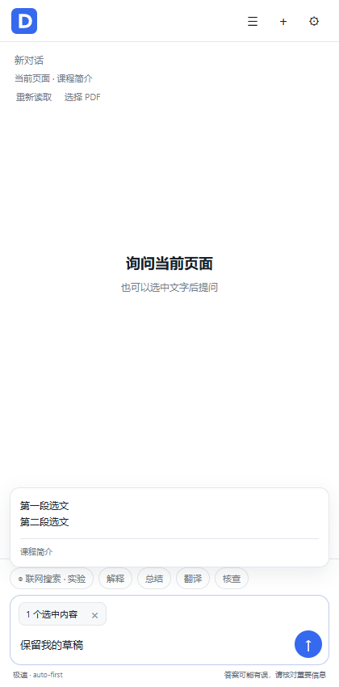

# DeepSeek Sidebar

在 Chrome 侧栏里，选中文字直接提问，也可以讨论当前网页、阅读长 PDF，或开启联网搜索。

**个人开发的非官方扩展，与 DeepSeek 没有官方合作或授权关系。** 使用你自己的 DeepSeek API Key，费用由你的 DeepSeek 账户承担。界面以中文为主，目前通过 Developer mode 本地安装，尚未发布到 Chrome Web Store。



*演示使用虚构课程页面和草稿，不含个人浏览记录；不是模型回答的效果截图。*

## 功能

- **选文提问**：自动带入网页选文；悬停预览、点击展开，重新划选自动替换。
- **跟随浏览**：读取当前网页；同标签页跳转和链接新开的标签页延续对话。手动新建标签页单独聊，历史恢复不跳转网页。
- **长 PDF 阅读**：本机索引全部文字页，模型按需搜索和读取后半部分；可明确选择分批全文阅读。
- **联网搜索（实验）**：调用 DeepSeek 官方兼容接口，最多展示 5 个去重来源。不调用第三方搜索 API；会增加 DeepSeek API 用量。
- **模型自动发现**：通过 `/models` 获取列表，无需手动更新模型名称；保留用户的模型选择。
- **对话管理**：本机保存、搜索、恢复、重命名和删除；空对话不进入历史。
- 支持流式输出、停止生成、深度思考、浅色/深色界面。

## Installation (Chrome)

1. Download the ZIP from **Releases**, or choose **Code → Download ZIP**.
2. Extract the ZIP. Locate the **DeepSeek-Chrome-Sidebar** folder containing `manifest.json`.
3. Open `chrome://extensions/`.
4. Turn on **Developer mode** (top right).
5. Click **Load unpacked**, then select **DeepSeek-Chrome-Sidebar** — not the repository root or the ZIP.
6. Click **Extensions → Pin** next to **DeepSeek 侧栏助手**.

Chrome manifest minimum: 116. Use a current Chrome release for the bundled PDF.js runtime; the minimum version is not a full compatibility guarantee.

## 配置与使用

1. 点击蓝色 D 图标打开侧栏，进入右上角设置。
2. 填写自己的 [DeepSeek API Key](https://platform.deepseek.com/api_keys)。**不要提交或分享 Key。**
3. 等待模型自动加载，选择模型；可点击“测试连接”或“刷新模型列表”，然后保存。
4. 划选网页文字后提问，或直接询问当前页面。Enter 发送，Shift+Enter 换行，Alt+Shift+D 带入选文并打开侧栏。

本地 PDF 可以点“选择 PDF”载入；如需直接读取 `file://` PDF，在 **chrome://extensions/ → Details → Allow access to file URLs** 开启权限。浏览器原生 PDF 阅读器内的选文不能自动带入，仍可针对文档和页码提问。

### Update an existing installation

Replace the files **inside the same originally loaded folder**. Open `chrome://extensions/` → **Reload** ↻. Close the sidebar, refresh the webpage, then reopen it. Keep the original folder path; uninstalling or loading from a different path may lose access to the original extension storage.

## 隐私与费用

**本机解析，不等于全程离线。** 提问时网页/PDF 的提取文字、选文、标题、网址、问题和对话上下文会发给 DeepSeek。PDF 二进制原文件不会上传；全文阅读会分批发送所有提取文字。

API Key 和历史保存在当前 Chrome 配置文件的扩展存储中，**不额外加密**。自动选文不会立即发送给模型，但会在本机暂存或随对话保存。配置 Key 时会自动访问模型列表接口。联网搜索可能包含模型从页面/选文提取的关键词。

无自己的中转服务器、广告或统计 SDK。服务商对收到的数据如何处理，以其政策为准。不要在敏感页面提问或处理未经允许上传的资料。全文阅读与搜索会产生额外 API 请求和费用，来源只显示 5 个不代表只检索了 5 个网页。

详见 [隐私与权限](PRIVACY.md)。

## 已知限制

- 网页正文最多提取 45,000 字符，选文最多 30,000 字符；不是浏览器完整控制代理，不会自动点击或操作网页。
- PDF 最大 60 MB。扫描件 OCR、图片理解、加密 PDF 尚不支持；全文笔记是摘要，不保证逐字无损记忆。
- 长文档提问最多 8 轮工具查阅；全文阅读更慢、更贵。未检查内容不能视为已核查。
- 联网搜索已有维护者报告的真实成功案例，仍属于实验能力，不保证全部账户/模型都可用。失败或未调用搜索时会明确提示，不能据此宣称已经联网。
- 只支持 DeepSeek 官方服务，不支持任意供应商 Base URL。模型列表自动更新不等于能自动兼容所有新参数能力。
- `chrome://` 等受保护页面无法读取；登录态、动态页面、网络策略和 PDF 下载权限也可能影响读取。
- Markdown 使用简易渲染器，复杂表格和嵌套格式可能显示不完整。

## 开发与测试

扩展无需构建，加载源码目录即可使用。测试使用 Node.js 24+；不会使用真实 Key，API 响应均为模拟。

```sh
npm ci
npm test
npx playwright install chromium
npm run test:ui
```

可用 `CHROME_PATH` 指定已安装 Chrome。实际 PDF 回归需自备合法可使用的文件，不随仓库分发论文：

```sh
npm run test:pdf -- "path/to/paper.pdf" "path/to/long-guide.pdf"
```

PDF 回归当前是固定场景：18 页 SeqAcademy v4 论文，以及可选的 456 页 Erasmus+ Programme Guide 2026。任意 PDF 不适用于这套固定断言。详见 [测试说明](docs/TESTING.md)。

## 发布、反馈与许可

- [发布到 GitHub 的步骤](docs/PUBLISH.md)
- [版本记录](CHANGELOG.md) · [发布说明](docs/RELEASE_NOTES.md)
- 提 Issue 时附版本、Chrome 版本、复现步骤和脱敏截图；不要附 API Key、私人文档或完整浏览记录。
- 自有代码采用 [MIT](LICENSE)；第三方 PDF.js、字体和 CMaps 保持各自许可，见 [第三方声明](THIRD_PARTY_NOTICES.md)。图标为独立绘制的蓝底白色 D，不使用官方鲸鱼资源。
